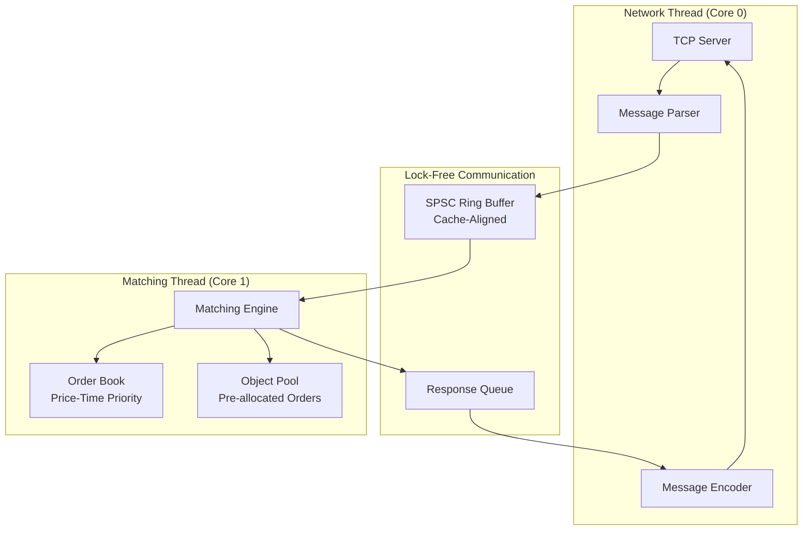

# Design Document: ApexLOB

## Overview

ApexLOB is an ultra-low-latency limit order book and matching engine designed to achieve sub-50 microsecond order-to-trade latency. The system employs a dual-thread architecture with lock-free communication, zero-allocation hot paths, and cache-optimized data structures. The design prioritizes predictable performance over peak throughput, using techniques from high-frequency trading systems.

The core architecture separates network I/O from order matching through a lock-free ring buffer, enabling the matching engine to operate without blocking on network operations. All critical data structures are pre-allocated and cache-aligned to minimize memory access latency and eliminate allocation overhead during order processing.

## Architecture

### High-Level System Architecture



### Thread Architecture

**Network Thread (Core 0):**
- Handles TCP connections using raw BSD sockets
- Parses incoming binary messages
- Enqueues parsed orders into the lock-free ring buffer
- Dequeues trade responses and sends them back to clients
- Applies backpressure when ring buffer is full

**Matching Thread (Core 1):**
- Dequeues orders from the ring buffer
- Performs order matching using price-time priority
- Updates the order book data structure
- Generates trade messages for matched orders
- Manages object lifecycle through the object pool

### Inter-Thread Communication

The system uses a Single-Producer Single-Consumer (SPSC) lock-free ring buffer for communication between threads. This design eliminates mutex contention and provides predictable latency characteristics.

**Ring Buffer Design:**
- Fixed-size circular buffer (power of 2 for efficient modulo operations)
- Cache-line aligned to prevent false sharing
- Uses atomic operations with memory_order_acquire/release semantics
- Supports backpressure when full (network thread slows down)

## Components and Interfaces

### Core Class Hierarchy

```cpp
// Core message types
struct alignas(64) Order {
    uint64_t order_id;
    uint64_t timestamp;
    uint64_t price;        // Fixed-point representation
    uint32_t quantity;
    uint16_t symbol_id;
    uint8_t side;          // 0=Buy, 1=Sell
    uint8_t type;          // 0=Limit, 1=Market
};

struct alignas(64) Trade {
    uint64_t trade_id;
    uint64_t timestamp;
    uint64_t buy_order_id;
    uint64_t sell_order_id;
    uint64_t price;
    uint32_t quantity;
    uint16_t symbol_id;
};

// Lock-free ring buffer for inter-thread communication
template<typename T, size_t Size>
class alignas(64) SPSCRingBuffer {
private:
    static_assert((Size & (Size - 1)) == 0, "Size must be power of 2");
    
    alignas(64) std::atomic<size_t> head_{0};
    alignas(64) std::atomic<size_t> tail_{0};
    alignas(64) std::array<T, Size> buffer_;

public:
    bool try_enqueue(const T& item) noexcept;
    bool try_dequeue(T& item) noexcept;
    bool is_full() const noexcept;
    bool is_empty() const noexcept;
    size_t size() const noexcept;
};

// Zero-allocation object pool
template<typename T, size_t Capacity>
class alignas(64) ObjectPool {
private:
    alignas(64) std::array<T, Capacity> objects_;
    alignas(64) std::array<T*, Capacity> free_list_;
    std::atomic<size_t> free_count_{Capacity};
    size_t free_head_{0};

public:
    T* acquire() noexcept;
    void release(T* obj) noexcept;
    size_t available() const noexcept;
    bool is_exhausted() const noexcept;
};

// Price level container for orders at same price
struct alignas(64) PriceLevel {
    uint64_t price;
    uint32_t total_quantity;
    uint32_t order_count;
    std::array<Order*, 64> orders;  // Fixed-size for cache efficiency
    
    void add_order(Order* order) noexcept;
    void remove_order(Order* order) noexcept;
    Order* get_first_order() const noexcept;
};

// Cache-optimized order book
class OrderBook {
private:
    // Use fixed-size arrays for known price ranges
    static constexpr size_t MAX_PRICE_LEVELS = 10000;
    static constexpr uint64_t MIN_PRICE = 1000000;  // $10.00 in fixed-point
    static constexpr uint64_t MAX_PRICE = 100000000; // $1000.00 in fixed-point
    
    alignas(64) std::array<PriceLevel, MAX_PRICE_LEVELS> bid_levels_;
    alignas(64) std::array<PriceLevel, MAX_PRICE_LEVELS> ask_levels_;
    
    // Fast lookup for best bid/ask
    std::atomic<uint64_t> best_bid_price_{0};
    std::atomic<uint64_t> best_ask_price_{UINT64_MAX};
    
    // Order ID to order mapping for cancellations
    std::unordered_map<uint64_t, Order*> order_map_;

public:
    void add_order(Order* order) noexcept;
    bool cancel_order(uint64_t order_id) noexcept;
    std::vector<Trade> match_order(Order* order) noexcept;
    
    uint64_t get_best_bid() const noexcept;
    uint64_t get_best_ask() const noexcept;
    uint32_t get_bid_quantity(uint64_t price) const noexcept;
    uint32_t get_ask_quantity(uint64_t price) const noexcept;
    
private:
    size_t price_to_index(uint64_t price) const noexcept;
    PriceLevel* get_bid_level(uint64_t price) noexcept;
    PriceLevel* get_ask_level(uint64_t price) noexcept;
};

// Main matching engine
class MatchingEngine {
private:
    OrderBook order_book_;
    ObjectPool<Order, 100000> order_pool_;
    ObjectPool<Trade, 50000> trade_pool_;
    SPSCRingBuffer<Order, 4096> incoming_orders_;
    SPSCRingBuffer<Trade, 4096> outgoing_trades_;
    
    std::atomic<bool> running_{false};
    std::thread matching_thread_;

public:
    void start() noexcept;
    void stop() noexcept;
    void process_orders() noexcept;  // Main matching loop
    
    bool submit_order(const Order& order) noexcept;
    bool get_trade(Trade& trade) noexcept;
    
private:
    void handle_order(Order* order) noexcept;
    void generate_trades(const std::vector<Trade>& trades) noexcept;
};

// Network layer
class TCPServer {
private:
    int server_fd_;
    int client_fd_;
    std::array<uint8_t, 4096> receive_buffer_;
    std::array<uint8_t, 4096> send_buffer_;
    
    MatchingEngine& engine_;
    std::atomic<bool> running_{false};
    std::thread network_thread_;

public:
    explicit TCPServer(MatchingEngine& engine, uint16_t port);
    ~TCPServer();
    
    void start() noexcept;
    void stop() noexcept;
    void run() noexcept;  // Main network loop
    
private:
    bool accept_connection() noexcept;
    bool receive_messages() noexcept;
    bool send_trades() noexcept;
    void configure_socket(int fd) noexcept;
};

// Wire protocol parser/encoder
class WireProtocol {
public:
    enum class MessageType : uint8_t {
        ADD_ORDER = 1,
        CANCEL_ORDER = 2,
        TRADE_EXECUTION = 3,
        ERROR_RESPONSE = 4
    };
    
    static bool parse_message(const uint8_t* buffer, size_t length, Order& order) noexcept;
    static size_t encode_trade(const Trade& trade, uint8_t* buffer) noexcept;
    static size_t encode_error(uint32_t error_code, uint8_t* buffer) noexcept;
    
private:
    static uint64_t read_uint64_be(const uint8_t* buffer) noexcept;
    static uint32_t read_uint32_be(const uint8_t* buffer) noexcept;
    static void write_uint64_be(uint8_t* buffer, uint64_t value) noexcept;
    static void write_uint32_be(uint8_t* buffer, uint32_t value) noexcept;
};
```

## Data Models

### Wire Protocol Specification

All multi-byte fields use network byte order (big-endian). Messages are fixed-size for parsing efficiency.

**Add Order Message (32 bytes):**
```
Offset | Size | Field        | Description
-------|------|--------------|------------------
0      | 1    | msg_type     | 1 = ADD_ORDER
1      | 1    | side         | 0 = Buy, 1 = Sell
2      | 2    | symbol_id    | Instrument identifier
4      | 4    | reserved     | Padding for alignment
8      | 8    | order_id     | Unique order identifier
16     | 8    | price        | Price in fixed-point (6 decimals)
24     | 4    | quantity     | Order quantity
28     | 4    | timestamp    | Client timestamp (optional)
```

**Cancel Order Message (16 bytes):**
```
Offset | Size | Field        | Description
-------|------|--------------|------------------
0      | 1    | msg_type     | 2 = CANCEL_ORDER
1      | 1    | reserved     | Padding
2      | 2    | symbol_id    | Instrument identifier
4      | 4    | reserved     | Padding for alignment
8      | 8    | order_id     | Order ID to cancel
```

**Trade Execution Message (40 bytes):**
```
Offset | Size | Field        | Description
-------|------|--------------|------------------
0      | 1    | msg_type     | 3 = TRADE_EXECUTION
1      | 1    | reserved     | Padding
2      | 2    | symbol_id    | Instrument identifier
4      | 4    | reserved     | Padding for alignment
8      | 8    | trade_id     | Unique trade identifier
16     | 8    | buy_order_id | Buyer's order ID
24     | 8    | sell_order_id| Seller's order ID
32     | 4    | price        | Execution price
36     | 4    | quantity     | Executed quantity
```

### Memory Layout Optimization

**Cache Line Alignment:**
- All critical structures aligned to 64-byte cache lines
- Ring buffer head/tail pointers on separate cache lines
- Order and Trade objects sized to fit cache line boundaries

**Fixed-Point Arithmetic:**
- Prices stored as 64-bit integers with 6 decimal places
- Example: $123.456789 stored as 123456789
- Eliminates floating-point precision issues and improves performance

**Data Structure Sizing:**
- Order struct: 64 bytes (1 cache line)
- Trade struct: 64 bytes (1 cache line)
- PriceLevel struct: 64 bytes + order array (cache-friendly)

## Correctness Properties

*A property is a characteristic or behavior that should hold true across all valid executions of a system—essentially, a formal statement about what the system should do. Properties serve as the bridge between human-readable specifications and machine-verifiable correctness guarantees.*

Based on the prework analysis, the following properties can be validated through property-based testing:

### Performance Properties

**Property 1: Sub-50 Microsecond Processing Latency**
*For any* valid order submitted to the matching engine, the processing time from receipt to completion should be less than 50 microseconds on a standard consumer CPU.
**Validates: Requirements 1.1**

**Property 2: Consistent Latency Under Load**
*For any* sustained load scenario with multiple concurrent orders, the 99th percentile latency should remain below 50 microseconds.
**Validates: Requirements 1.2**

**Property 3: Zero Hot Path Allocations**
*For any* order processing operation on the hot path, no dynamic memory allocations (malloc/new) should occur.
**Validates: Requirements 1.3**

### Concurrency Properties

**Property 4: Lock-Free Message Transfer**
*For any* message sent by the Network_Thread, it should be successfully received by the Matching_Thread through the lock-free ring buffer without data corruption.
**Validates: Requirements 2.1**

**Property 5: SPSC Semantics Without Locks**
*For any* ring buffer implementation, no mutexes or condition variables should be used in the enqueue/dequeue operations.
**Validates: Requirements 2.2**

**Property 6: Concurrent Access Correctness**
*For any* concurrent enqueue and dequeue operations on the ring buffer, data integrity should be maintained across CPU cores using only atomic operations and memory barriers.
**Validates: Requirements 2.4**

### Protocol Properties

**Property 7: Wire Protocol Round Trip**
*For any* valid order, encoding it to binary format and then decoding should produce an equivalent order object.
**Validates: Requirements 3.2**

**Property 8: Network Byte Order Consistency**
*For any* multi-byte field in the wire protocol, encoding and decoding should correctly handle big-endian byte order.
**Validates: Requirements 3.3**

**Property 9: Message Validation**
*For any* incoming message, invalid message types or lengths should be rejected before processing, while valid messages should be accepted.
**Validates: Requirements 3.4**

### Memory Management Properties

**Property 10: Object Pool Constant Time Access**
*For any* object acquisition from the pool, the operation should complete in O(1) time regardless of pool state.
**Validates: Requirements 4.2**

**Property 11: Zero-Allocation Object Recycling**
*For any* object release operation, no dynamic deallocation (free) should occur.
**Validates: Requirements 4.3**

### Order Book Properties

**Property 12: Price Priority Matching (Buy Orders)**
*For any* buy order and order book state, the order should be matched against the lowest available sell price first.
**Validates: Requirements 5.1**

**Property 13: Price Priority Matching (Sell Orders)**
*For any* sell order and order book state, the order should be matched against the highest available buy price first.
**Validates: Requirements 5.2**

**Property 14: Time Priority Within Price Levels**
*For any* set of orders at the same price level, they should be matched in first-in-first-out (FIFO) order.
**Validates: Requirements 5.3**

**Property 15: Partial Fill Preservation**
*For any* partially filled order, the remaining quantity should maintain its original priority position in the order book.
**Validates: Requirements 5.4**

**Property 16: Efficient Price Level Lookup**
*For any* price level lookup operation, the time complexity should be O(log N) or better.
**Validates: Requirements 6.1**

### Order Lifecycle Properties

**Property 17: Immediate Matching Attempt**
*For any* valid incoming order, the matching engine should attempt to match it immediately upon receipt.
**Validates: Requirements 7.1**

**Property 18: Unmatched Quantity Insertion**
*For any* order that cannot be fully matched, the remaining quantity should be correctly inserted into the order book.
**Validates: Requirements 7.2**

**Property 19: Order Cancellation**
*For any* valid cancel request, the specified order should be successfully removed from the order book.
**Validates: Requirements 7.3**

**Property 20: Trade Message Generation**
*For any* matched order, appropriate trade messages should be generated for both the aggressor and resting orders.
**Validates: Requirements 7.5**

### Error Handling Properties

**Property 21: Invalid Message Resilience**
*For any* invalid message received, the system should log the error and continue processing subsequent messages without crashing.
**Validates: Requirements 11.1**

**Property 22: Field Validation**
*For any* message with invalid field values (price ≤ 0, quantity ≤ 0), the message should be rejected before processing.
**Validates: Requirements 11.4**

<function_calls>
<invoke name="prework">
<parameter name="featureName">apex-lob

## Error Handling

### Network Layer Error Handling

**Connection Management:**
- TCP connections are handled gracefully with proper socket cleanup
- Unexpected disconnections trigger resource cleanup and allow new connections
- Socket configuration includes TCP_NODELAY and appropriate buffer sizes
- Non-blocking I/O with proper error code handling

**Message Parsing Errors:**
- Invalid message types are logged and ignored
- Malformed messages (wrong length, invalid fields) are rejected
- Parsing continues with the next message after encountering errors
- Error responses are sent back to clients for invalid requests

### Matching Engine Error Handling

**Resource Exhaustion:**
- Object pool exhaustion results in order rejection with specific error codes
- Ring buffer full condition triggers backpressure to network thread
- Memory allocation failures are handled gracefully without system crash

**Order Validation:**
- Price and quantity validation (must be > 0)
- Order ID uniqueness checking
- Symbol ID validation against supported instruments
- Side and type field validation

**Cancellation Errors:**
- Non-existent order ID cancellation returns appropriate error response
- Already-filled orders cannot be cancelled (error response)
- Partial cancellations are not supported (design simplification)

### RAII and Resource Management

**Automatic Resource Cleanup:**
- All socket file descriptors managed with RAII wrappers
- Object pool objects automatically returned on scope exit
- Thread lifecycle managed with proper join/detach semantics
- Memory-mapped regions (if used) properly unmapped on destruction

## Testing Strategy

### Dual Testing Approach

The testing strategy employs both unit tests and property-based tests to ensure comprehensive coverage:

**Unit Tests:**
- Verify specific examples and edge cases
- Test integration points between components
- Validate error conditions and boundary cases
- Focus on concrete scenarios with known expected outcomes

**Property-Based Tests:**
- Verify universal properties across all inputs
- Use randomized input generation for comprehensive coverage
- Test invariants that must hold regardless of specific inputs
- Validate performance characteristics under various conditions

### Property-Based Testing Configuration

**Testing Framework:** Google Test with custom property-based testing utilities
**Minimum Iterations:** 1000 iterations per property test (due to performance requirements)
**Test Tagging:** Each property test references its design document property

**Tag Format:** `// Feature: apex-lob, Property {number}: {property_text}`

**Example Property Test Structure:**
```cpp
// Feature: apex-lob, Property 1: Sub-50 Microsecond Processing Latency
TEST(MatchingEngineProperties, ProcessingLatencyUnder50Microseconds) {
    for (int i = 0; i < 1000; ++i) {
        Order random_order = generate_random_order();
        auto start = std::chrono::high_resolution_clock::now();
        
        engine.process_order(random_order);
        
        auto end = std::chrono::high_resolution_clock::now();
        auto duration = std::chrono::duration_cast<std::chrono::microseconds>(end - start);
        
        EXPECT_LT(duration.count(), 50) << "Order processing exceeded 50μs: " << duration.count() << "μs";
    }
}
```

### Performance Testing

**Latency Measurement:**
- Use `std::chrono::high_resolution_clock` for microsecond precision
- Measure end-to-end latency from message receipt to trade generation
- Report p50, p99, and p999 latency percentiles
- Validate latency consistency under sustained load

**Throughput Testing:**
- Measure orders processed per second
- Test with various order size distributions
- Validate performance under different market conditions (trending vs. choppy)

**Memory Performance:**
- Verify zero allocations on hot path using custom allocator hooks
- Measure cache hit rates using performance counters
- Validate object pool efficiency and fragmentation

### Integration Testing

**End-to-End Pipeline:**
- Test complete flow from TCP message to trade response
- Validate message parsing, matching, and response encoding
- Test error propagation through the entire system
- Verify thread communication under load

**Stress Testing:**
- Sustained high-frequency order submission
- Burst traffic patterns
- Resource exhaustion scenarios
- Network disconnection and reconnection

### Test Data Generation

**Order Generation:**
- Random price distributions within realistic ranges
- Various quantity sizes (small fills to large blocks)
- Different order types and sides
- Invalid orders for error path testing

**Market Scenario Generation:**
- Trending markets (directional price movement)
- Volatile markets (high bid-ask spread changes)
- Quiet markets (sparse order flow)
- Crossed markets (error conditions)

## Project Structure

```
apex-lob/
├── CMakeLists.txt
├── README.md
├── src/
│   ├── matching_engine/
│   │   ├── matching_engine.cpp
│   │   ├── order_book.cpp
│   │   └── object_pool.cpp
│   ├── network/
│   │   ├── tcp_server.cpp
│   │   └── wire_protocol.cpp
│   ├── common/
│   │   ├── spsc_ring_buffer.cpp
│   │   └── types.cpp
│   └── main.cpp
├── include/
│   ├── apex_lob/
│   │   ├── matching_engine/
│   │   │   ├── matching_engine.h
│   │   │   ├── order_book.h
│   │   │   └── object_pool.h
│   │   ├── network/
│   │   │   ├── tcp_server.h
│   │   │   └── wire_protocol.h
│   │   ├── common/
│   │   │   ├── spsc_ring_buffer.h
│   │   │   └── types.h
│   │   └── config.h
├── tests/
│   ├── unit/
│   │   ├── test_matching_engine.cpp
│   │   ├── test_order_book.cpp
│   │   ├── test_object_pool.cpp
│   │   ├── test_ring_buffer.cpp
│   │   └── test_wire_protocol.cpp
│   ├── property/
│   │   ├── test_matching_properties.cpp
│   │   ├── test_performance_properties.cpp
│   │   └── test_concurrency_properties.cpp
│   ├── integration/
│   │   ├── test_end_to_end.cpp
│   │   └── test_stress.cpp
│   └── CMakeLists.txt
├── benchmarks/
│   ├── bench_matching_engine.cpp
│   ├── bench_order_book.cpp
│   ├── bench_ring_buffer.cpp
│   └── CMakeLists.txt
├── scripts/
│   ├── build.sh
│   ├── run_tests.sh
│   ├── run_benchmarks.sh
│   └── setup_cpu_affinity.sh
└── docs/
    ├── architecture.md
    ├── wire_protocol.md
    └── performance_tuning.md
```

### Build System Configuration

**CMakeLists.txt (Root):**
```cmake
cmake_minimum_required(VERSION 3.20)
project(ApexLOB VERSION 1.0.0 LANGUAGES CXX)

set(CMAKE_CXX_STANDARD 20)
set(CMAKE_CXX_STANDARD_REQUIRED ON)

# Optimization flags for release builds
set(CMAKE_CXX_FLAGS_RELEASE "-O3 -DNDEBUG -march=native -mtune=native")
set(CMAKE_CXX_FLAGS_DEBUG "-O0 -g -fsanitize=address -fsanitize=thread")

# Warning flags
set(CMAKE_CXX_FLAGS "${CMAKE_CXX_FLAGS} -Wall -Wextra -Wpedantic -Werror")

# Find required packages
find_package(GTest REQUIRED)
find_package(benchmark REQUIRED)

# Include directories
include_directories(include)

# Add subdirectories
add_subdirectory(src)
add_subdirectory(tests)
add_subdirectory(benchmarks)
```

This comprehensive design provides the foundation for implementing an ultra-low-latency limit order book with all the performance characteristics required for high-frequency trading applications.